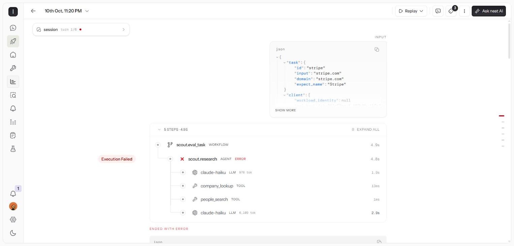
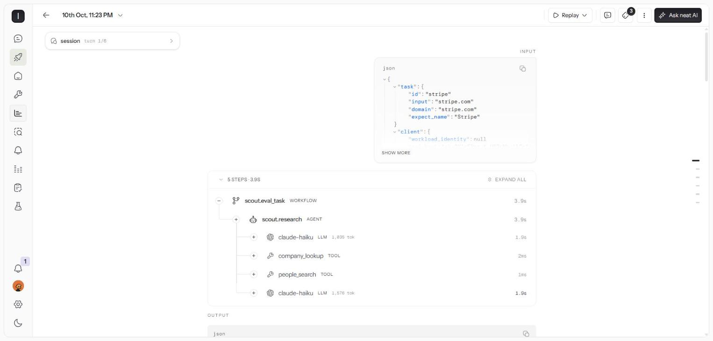
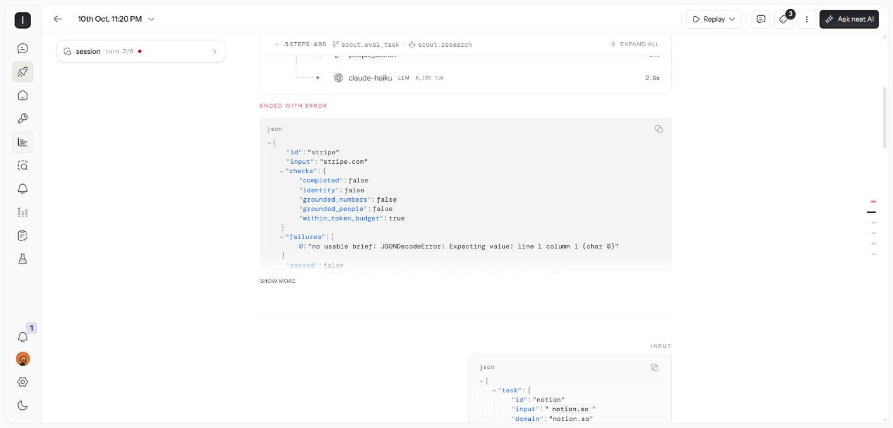
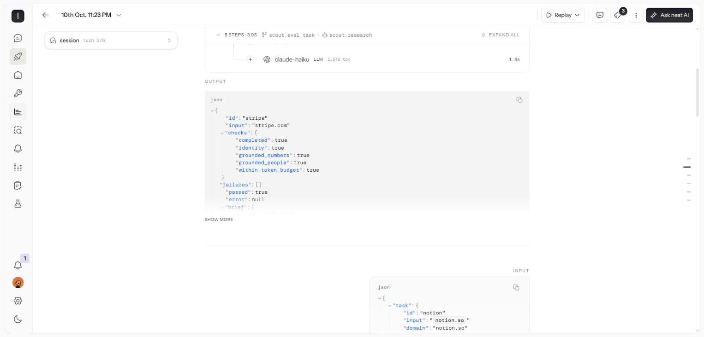
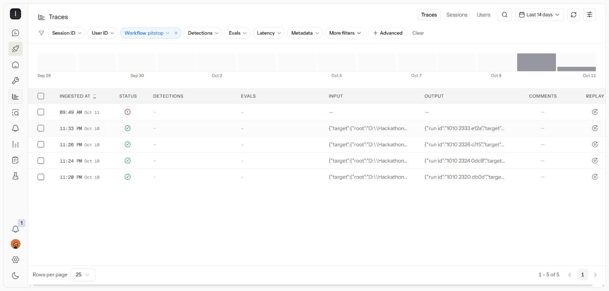
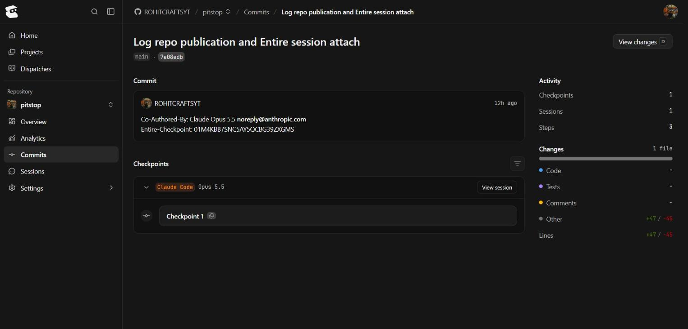
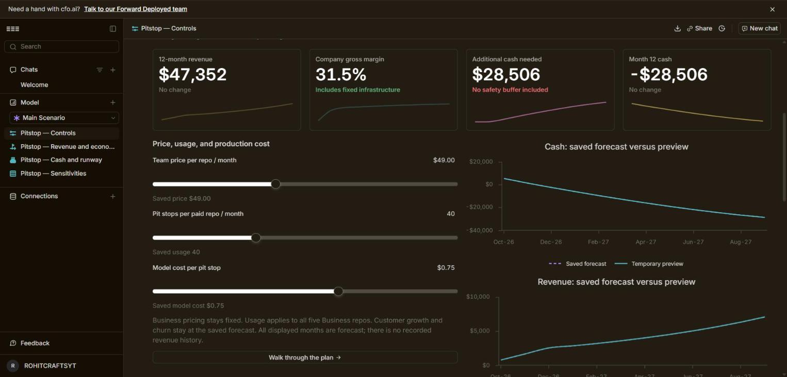
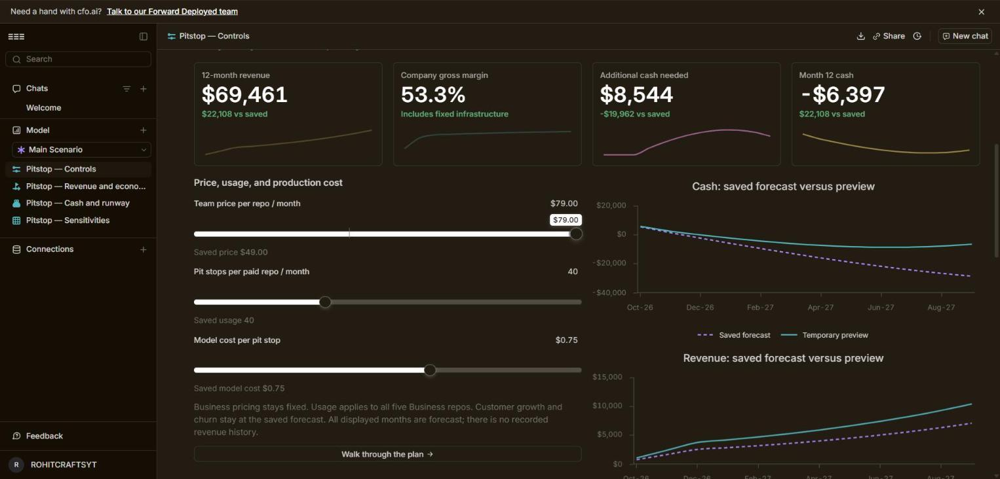

# Evidence

Screenshots from the neatlogs dashboard, entire.io and cfo.ai, captured 2026-10-11.
The neatlogs project and the cfo.ai workspace are private to the team, so these
images are how reviewers can see them.

## neatlogs: the agent improved

Same eval task (`stripe`) before and after the first real pit stop
([report](../../reports/pitstop-1010-2320-db0d.md)).

| Before (trace `4f00c2ed…`) | After (trace `3a6ac2bc…`) |
|---|---|
|  |  |
|  |  |

Before: `scout.research` ends in ERROR, and the final LLM step uses 6,109 tokens
because the full people profiles are in context. The output shows the
`JSONDecodeError` that Pitstop reads back as evidence. After: no error, the final
step uses 1,576 tokens, and every check passes.

Pitstop's own runs are traced as the `pitstop` workflow:

## Entire

Checkpoint `01M4KBB7SNC5AY5QCBG39ZXGMS` on commit `7e08edb`:
https://entire.io/gh/ROHITCRAFTSYT/pitstop/commit/7e08edba996ee741b17848e3abad7e534df54c5c

Entire Graph output, as used inside Pitstop's localize step:
[entire-graph-search.txt](entire-graph-search.txt). The top hit is
`scout/agent.py` with focus on line 43, the bare `json.loads` that Pitstop's
first fix replaces.

## cfo.ai

Live model: https://cfo.ai/s/W2RB_otvpzPIaBn6. Write-up: [../business-plan.md](../business-plan.md).

| Base case, Team at $49 | Preview, Team at $79 |
|---|---|
|  |  |
